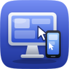
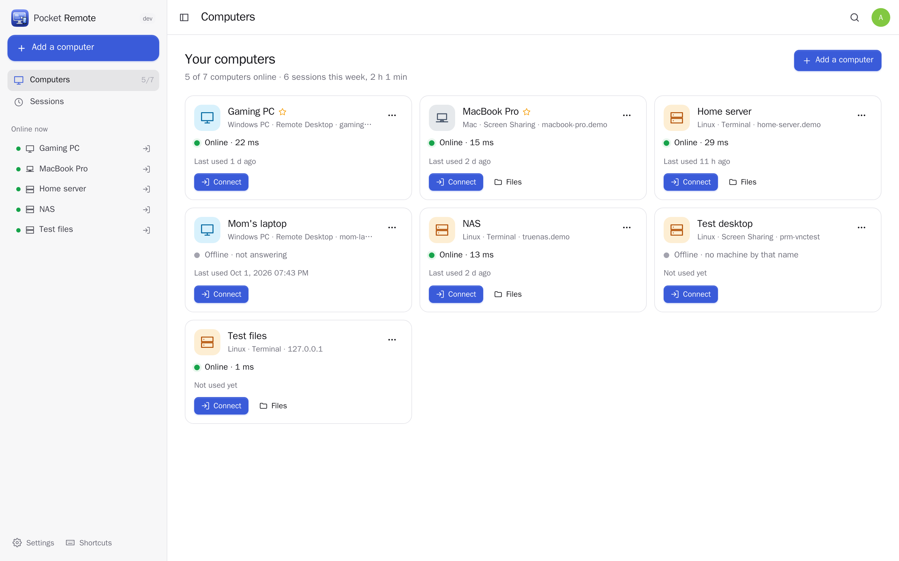
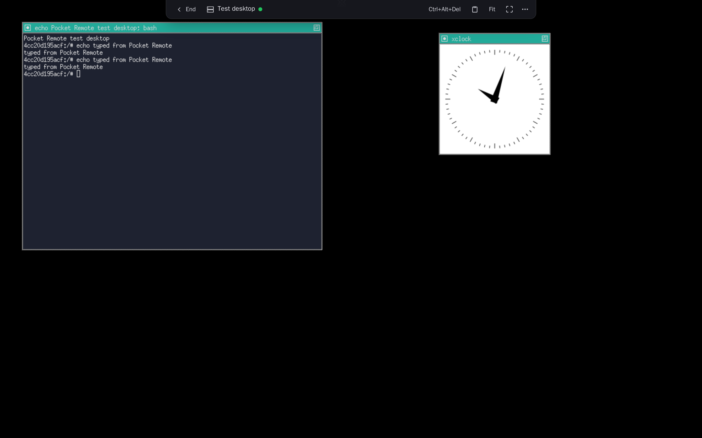
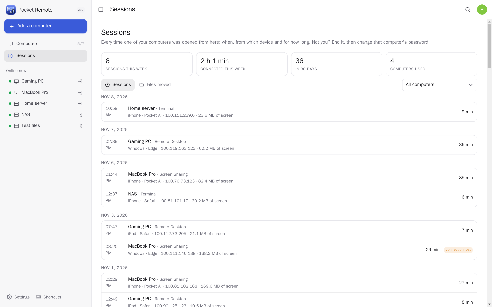
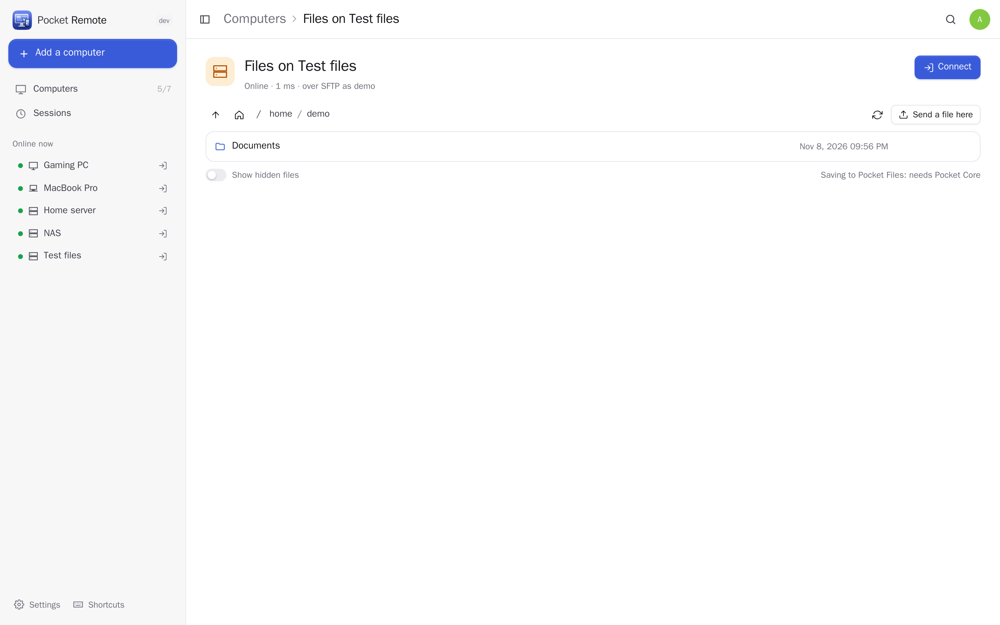
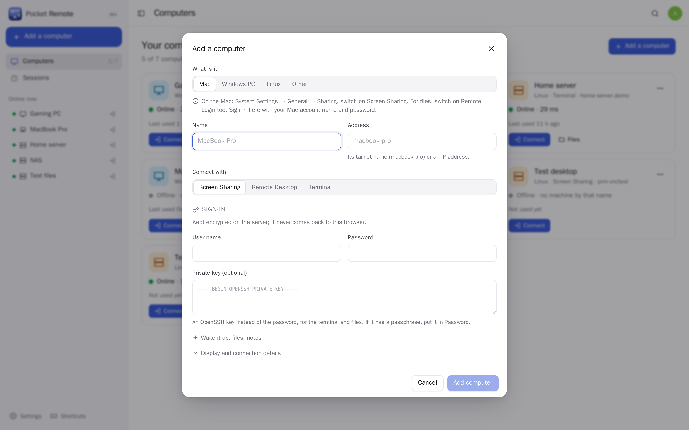
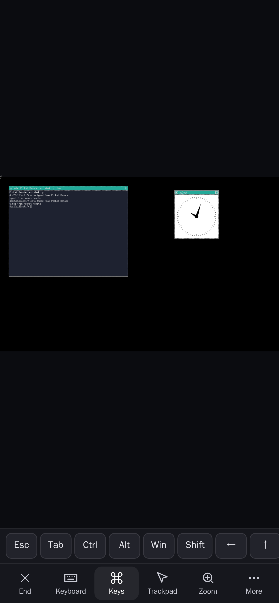
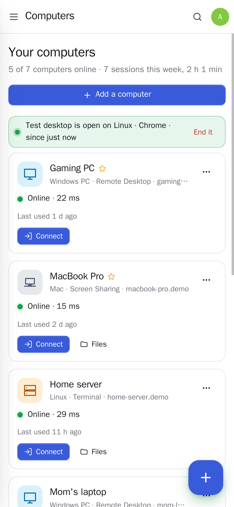

<p align="center"></p>
<h1 align="center">Pocket Remote</h1>
<p align="center">Your own computers, from a phone or a browser. Open your Mac's screen, a Windows PC or a Linux terminal over your tailnet, with nothing to install on the phone and nothing opened to the internet. See which computers are on, wake one up, move files to and from it (or straight into Pocket Files), and keep a log of every session with a message when one opens. A touch bar makes a desktop usable on a phone: trackpad or direct touch, the keys a phone keyboard lacks, zoom that follows the pointer, clipboard and "type it out" for sign-in screens. The remote desktop work is done by Apache Guacamole's guacd; passwords stay sealed on the server.<br>One Go binary, one SQLite file, one volume. Part of the Pocket apps; works on its own too.</p>
<p align="center">
  <a href="https://github.com/abjelosevic88/pocket-homelab-remote/actions"></a>
  <a href="https://github.com/abjelosevic88/pocket-homelab-remote/pkgs/container/pocket-homelab-remote"></a>
  <a href="LICENSE"></a>
</p>

---

<p align="center"></p>

<table>
  <tr>
    <td width="50%"></td>
    <td width="50%"></td>
  </tr>
  <tr>
    <td align="center"><sub>A session: the computer's screen in the browser, a slim bar at the top for Ctrl+Alt+Del, clipboard, files and full screen.</sub></td>
    <td align="center"><sub>Every session: which computer, from which device and address, for how long.</sub></td>
  </tr>
  <tr>
    <td width="50%"></td>
    <td width="50%"></td>
  </tr>
  <tr>
    <td align="center"><sub>Files: browse, download, send a file to it, or save one into Pocket Files.</sub></td>
    <td align="center"><sub>Add a Mac, a Windows PC or a Linux machine, by hand or from your tailnet.</sub></td>
  </tr>
</table>

<p align="center">
  &nbsp;&nbsp;
  
</p>

## What it does

- **Your computers**: Mac (Screen Sharing / VNC), Windows (Remote Desktop / RDP), Linux (VNC, RDP or a terminal over SSH). Add them by hand or pick them from the box's tailnet. Every minute each one is checked: online with its latency, or why not ("Screen Sharing is switched off on it").
- **Sessions in the browser**: the screen fits the window or shows at actual size; on a computer the mouse and keyboard just work, on a phone the touch bar gives a trackpad or direct touch, a keyboard, a row of Esc/Tab/Ctrl/Alt/⌘/Win/arrows/F-keys (modifiers stay pressed for the next key), zoom that follows the pointer, Ctrl+Alt+Del, clipboard both ways and "type it out" for sign-in screens. Remote Desktop can follow the window size and play the PC's sound.
- **Wake-on-LAN**: wake a sleeping computer from your phone; the card shows it coming up.
- **Files** over SFTP with the same sign-in: browse, download here, send a file there, save straight into your Pocket Files without passing through the phone. The machine's SSH identity is learned once and checked every time.
- **Safe by default**: passwords and keys sealed with AES-256-GCM and never sent to a browser; an optional connect PIN on top of your sign-in (locks after five wrong tries); each session needs a one-time ticket; a message whenever a session opens; end any open session from another device; everything per person, admins see no one else's computers.

## Run it

```sh
docker compose up -d     # pocket-remote + guacd, host networking — see docker-compose.yml
```

Host networking lets Wake-on-LAN reach your home network and keeps guacd on `127.0.0.1`. Open it, create the first account and add a computer. All options: [docs/configuration.md](docs/configuration.md). API: [docs/api.md](docs/api.md). Back up `data/remote.key` with the database.

## With Pocket Core

Set `CORE_URL` and `CORE_REGISTRATION_KEY` and Remote joins the box: people sign in with Pocket Core, and "Save to Pocket Files" reaches each person's own Pocket Files with nothing to paste. Other Pocket apps can see your computers and the session log (`remote:read`: Pocket AI, Day, dashboards) or wake one (`remote:wake`: "wake my PC"); no link ever reaches a session, files or a password. Events on the bus: `remote.session_started`, `remote.session_ended`, `remote.machine_woken`, `remote.file_saved`. Without Core, Pocket Files can be connected directly with a URL and a token; the Core-only choices stay visible, greyed out.

## Develop

```sh
make dev     # API on :8080 with demo data + Vite on :5173 (start guacd too: docker compose up -d guacd)
make test    # go vet, go test, tsc
make         # web + binary
```

MIT licensed. Uses [Apache Guacamole](https://guacamole.apache.org/) (guacd and guacamole-common-js, Apache License 2.0).
